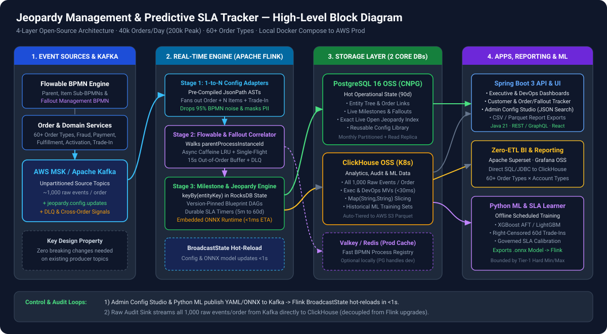
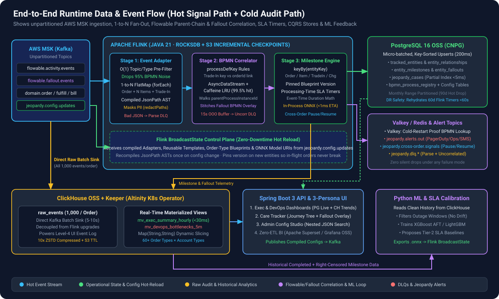
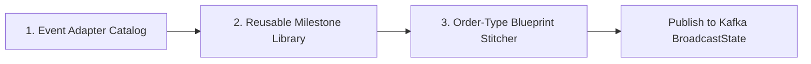
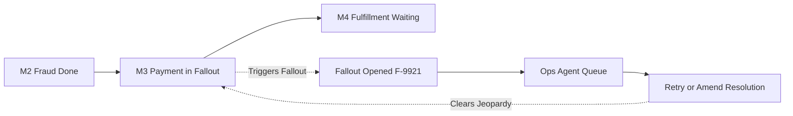

# Jeopardy Management & Predictive SLA Tracker — Clean Architecture (v3.4)

> **Living Design Document (v3.4)** — 4-layer open-source architecture tailored for **~40k orders/day (200k launch-day 5x spikes)**, **60+ order types & multiple account types**, **unpartitioned AWS MSK**, **Flowable `(processInstanceId, parentProcessInstanceId)` + Fallout Management BPMN**, **Admin-UI Reusable Milestone Templates with Nested JSON Search**, **Executive/DevOps Slicing & BI Reporting**, and **1:1 Local Docker Compose parity**.

---

## 1. High-Level Block Diagram (Components at a Glance)



---

## 2. End-to-End Runtime Data & Event Flow



---

## 3. Admin-Driven Reusable Onboarding (Built for 60+ Order Types)

Instead of copy-pasting event rules across 60 YAML files, onboarding is driven from an **Admin Configuration UI** (backed by versioned PostgreSQL tables + Git export) structured into **3 reusable building blocks**:



### Block 1: Event Adapter Catalog & Nested JSON Search (Admin UI)
- Admin selects a Kafka topic, pastes a sample JSON payload, and uses **Live Nested JSON Search** (recursively indexing keys & values across nested objects and arrays) to click any field and bind its normalized JSONPath (`$.lineItems[*].tradeIn.tradeInOrderId`, `$.variables.fallout.errorCode`, etc.) as an `entityKey`, `relatedLink`, ClickHouse slice `dimension`, or **Milestone Detection Predicate** (`==`, `in`, `exists`).
- Clicking **"Run Live Dry-Run"** evaluates the 1-to-N fan-out extraction and milestone detection live before saving.
- **Runtime Scale Guardrail (Flink):** Never run uncompiled recursive scans (`$..`) on all 1,000 raw events/order. When configs hot-reload via `BroadcastState`, Flink pre-compiles each rule into **compiled Jayway JsonPath / Jackson JsonPointer ASTs** guarded by an O(1) top-level `topic` + `eventType` / `processDefinitionKey` pre-filter, delivering **<50 µs** nested extraction after dropping ~95% Flowable noise.

### Block 2: Reusable Milestone Template Library (Define Once, Reuse Everywhere)
- Define canonical milestone templates once in Admin UI (stored in `config_milestone_templates`):
  - `TMPL_ORDER_RECEIVED` (Default Name: `"Order Received"`)
  - `TMPL_FRAUD_CHECK` (Default Name: `"Fraud Validation"`)
  - `TMPL_PAYMENT_AUTH` (Default Name: `"Payment Authorization"`)
  - `TMPL_FULFILLMENT_SHIP` (Default Name: `"Fulfillment & Shipping"`)
  - `TMPL_ESIM_ACTIVATION` (Default Name: `"Device Activation"`)
  - `TMPL_BILLING_SYNC` (Default Name: `"Billing Updates"`)
  - `TMPL_ORDER_CLOSED` (Default Name: `"Order Closed"`)
- Each template binds its `startTriggers`, `completeTriggers`, `failTriggers`, default `SLA`, and optional `ML modelId` **once**.

### Block 3: Order-Type / Item-Type Blueprint Stitcher (Reuse + Override Name & SLA)
- To onboard any of your **60+ order types** (or `orderItemType`s), an admin picks reusable templates from the library, stitches their DAG sequence (`dependsOn`), and **overrides the `displayName` and `SLA` per order type**:

```yaml
blueprints:
  - id: bp-sales-iphone-ship-to-home
    orderType: "SALES_UPGRADE"
    itemType: "HANDSET_SHIP_TO_HOME"
    steps:
      - stepId: S1
        useTemplate: "TMPL_ORDER_RECEIVED"
        displayName: "iPhone Upgrade Order Placed"
      - stepId: S2
        useTemplate: "TMPL_FRAUD_CHECK"
        displayName: "Identity & Device Fraud Check"
        dependsOn: ["S1"]
      - stepId: S3
        useTemplate: "TMPL_PAYMENT_AUTH"
        displayName: "Tax & Down-Payment Capture"
        dependsOn: ["S2"]
      - stepId: S4
        useTemplate: "TMPL_FULFILLMENT_SHIP"
        displayName: "iPhone Ship-to-Home Delivery"
        dependsOn: ["S3"]
        slaOverride: { mode: "ML_PREDICTED", hardMax: "7d" }

  - id: bp-tradein-google-10-pro
    orderType: "TRADE_IN"
    itemType: "DEVICE_TRADE_IN"
    steps:
      - stepId: T1
        useTemplate: "TMPL_ORDER_RECEIVED"
        displayName: "Trade-In Quote Locked ($650)"
      - stepId: T2
        useTemplate: "TMPL_FULFILLMENT_SHIP"
        displayName: "Prepaid Return Kit Shipped"
        dependsOn: ["T1"]
        slaOverride: { mode: "STATIC", expected: "2.5d", hardMax: "7d" }
```

> **Reporting Superpower:** Every tracked milestone stores BOTH `template_id` (`TMPL_FULFILLMENT_SHIP`) and `display_name` (`"iPhone Ship-to-Home Delivery"` vs `"Prepaid Return Kit Shipped"`). Customers & Care see the tailored business name, while DevOps & Executives roll up across all 60 order types by `template_id`.

---

## 4. First-Class Fallout Management BPMN Integration

When any Flowable task fails for any reason, your **Fallout Management BPMN (`falloutManagementBpmn`)** triggers automatically. We attach it as a **first-class `Fallout Overlay` directly onto the impacted Order or Order Item AND its failing milestone**:



1. **Automatic Correlation (Stage 2):** `falloutManagementBpmn` links to the failed Order (`ORD-88412`) or Order Item (`ORD-88412:ITM-1`) via `parentProcessInstanceId` (walking `bpmn_process_registry`) OR explicit fallout variables (`failedOrderId`, `failedOrderItemId`, `failedActivityId`, `falloutId`, `errorCode`, `assignedQueue`).
2. **Stored in PostgreSQL (`entity_fallouts`) + Streamed to ClickHouse:** Tracks `OPEN → IN_QUEUE → RETRYING → RESOLVED` inline on the milestone & timeline, and unlocks **Fallout Rate %**, **Ops Queue Backlog**, and **Fallout MTTR** in ClickHouse.

---

## 5. Universal Entity Model & Flowable `(processInstanceId, parentProcessInstanceId)` Correlation

- **Universal `TrackedEntity` (`entityKey`):** Orders (`ORD-88412`), Order Items (`ORD-88412:ITM-1`), 60-day Trade-Ins (`TRD-55091`), Short-Lived Change Orders (`CHG-10294`), and Internally-Triggered Free Insurance (`INS-77301`) all run independent Milestone DAGs and RocksDB TTLs in Flink Stage 3, linked via `entity_relationships`.
- **Flowable Parent-Chain Resolution (Stage 2):**
  - Process-definition-scoped rules distinguish primary keys from links (e.g., `tradeInMainBpmn` uses `tradeInOrderId` as `entityKey` and treats `orderId: abcd` as a `BUNDLED_FEATURE` link).
  - For nested Sub-BPMNs carrying `(processInstanceId, parentProcessInstanceId)`, Flink uses **`AsyncDataStream` + Caffeine LRU Cache** (~99.5% hit rate) + **Single-Flight coalescing** backed by PostgreSQL locally and **Valkey/Redis** in AWS production, with a 15-second RocksDB out-of-order buffer + `jeopardy.dlq.uncorrelated`.

---

## 6. Executive & DevOps Slicing, 60+ Order Types & BI Reporting (ClickHouse)

1. **Order Family Taxonomy (`config/taxonomy/order-families.yaml`):** Rolls up 60+ order types into ~6–8 executive portfolios with 1-click drill-down to any individual order type.
2. **Dynamic Slicing Without Schema Migrations:** Indexed core slice columns (`order_family`, `order_type`, `item_type`, `account_type`, `channel`, `region`, `domain`, `template_id`, `milestone_id`, `status`, `error_code`, `has_fallout`) + ClickHouse `Map(String, String)` `dimensions`.
3. **Exact Live vs. Historical Query Split:**
   - **Current Live Open Jeopardy/Fallout:** PostgreSQL partial index (`<5ms`, 100% ACID exact — zero double-counting).
   - **Historical Volume, SLA %, P50/P90 Trends, 5-Min Error Storms & MTTR:** ClickHouse `AggregatingMergeTree` Materialized Views (`mv_exec_summary_hourly`, `mv_devops_bottlenecks_5m`, `<30ms`).
4. **Zero-ETL Reporting & BI:** Connect **Apache Superset** and **Grafana OSS** (or any SQL/JDBC BI tool) directly to ClickHouse Materialized Views, plus streaming **CSV / Excel / Parquet** exports from Spring Boot and automatic S3 archival.

---

## 7. Predictive ETA & Governed SLA Learning (3 Tiers)

1. **Tier 1 — Hard Min/Max Guardrails:** Configured in Milestone Template / Blueprint overrides; never auto-overwritten by ML.
2. **Tier 2 — Learned Segment Baselines:** Periodic Python job reads completed milestones from ClickHouse (excluding outage windows), computes `P50 / P75 / P90` by `(template_id, order_type, account_type, dimensions['donor_carrier'])`, and proposes bounded updates to the Admin Config UI for approval.
3. **Tier 3 — Real-Time Predicted ETA:** Python trains **XGBoost AFT / LightGBM** (handling right-censored 60-day open trade-ins), exports `.onnx`, and **Java Flink runs ONNX Runtime in-process (<1ms)** with instant fallback to Tier-2 baselines.

---

## 8. 100% Open-Source Stack: Local Docker Compose to Production K8s / Cloud Foundry

**Every new component is 100% Open-Source** (no ClickHouse Cloud, no proprietary SaaS lock-in):

| Component | Local Docker Compose (~4 GB RAM) | Production (100% Open-Source on K8s / Cloud Foundry) |
| :--- | :--- | :--- |
| **Event Bus** | `apache/kafka` (KRaft — Apache 2.0) | Existing **AWS MSK** (or **Strimzi Kafka Operator** on K8s) |
| **Stream Engine** | `flink:1.20-java21` (Apache 2.0) | **Apache Flink OSS** on **Kubernetes** via **Apache Flink K8s Operator** |
| **Operational & Config DB** | `postgres:16-alpine` (PostgreSQL License) | **PostgreSQL 16 OSS** on **Kubernetes** via **CloudNativePG Operator** *(or existing org Postgres)* |
| **Raw Audit, OLAP & ML Data** | `clickhouse/clickhouse-server:24-alpine` (Apache 2.0) | **ClickHouse OSS + ClickHouse Keeper** on **Kubernetes** via **Altinity ClickHouse Operator** + S3 Cold Tiering |
| **Process Cache (Prod Optional)** | Built-in Caffeine + PG (Optional `valkey:8-alpine`) | **Valkey 8 OSS** (BSD-3, Linux Foundation) on K8s Sentinel |
| **API, Admin Studio & UI** | `spring-boot-jeopardy-api` (Java 21) + React | **Spring Boot 3 + React** on **Cloud Foundry** (or Kubernetes) |
| **BI & Reporting** | `grafana/grafana` or `apache/superset` (`--profile bi`) | **Apache Superset** (Exec BI) + **Grafana OSS** (DevOps/SRE) on K8s |
| **ML Trainer (On-Demand)** | `python-ml-trainer` (`--profile ml`) | **K8s CronJob** (XGBoost AFT / LightGBM → **ONNX Runtime**) |

### Local Kafka Topics & Multi-Domain Payload Simulator
Because local development runs without AWS MSK, `docker-compose.yml` runs **Apache Kafka (KRaft mode)** locally and ships with a **Multi-Domain Payload Simulator** publishing realistic, deliberately **unpartitioned** (round-robin/default key) JSON payloads across all source topics:
- **Source Domain & BPMN Topics:** `flowable.activity.events` (parent, item sub-BPMNs, deep sub-BPMNs with only `processInstanceId`/`parentProcessInstanceId`, Trade-In BPMNs with extra `orderId` keys, plus ~95% BPMN micro-event noise), `flowable.fallout.events`, `domain.order.events`, `domain.fraud.events`, `domain.payment.events`, `domain.fulfillment.events`, `domain.provisioning.events`, and `domain.billing.events`.
- **Internal Jeopardy Topics:** `jeopardy.config.updates` (compacted), `jeopardy.cross-order.signals` (keyed by target `entityKey`), `jeopardy.ui.updates` (SSE push deltas), `jeopardy.alerts.out`, `jeopardy.dlq.parse-errors`, and `jeopardy.dlq.uncorrelated`.

---

## 9. Production Hardening, Cloud Foundry/K8s Topology & Disaster Recovery

Full capacity sizing math (40k/day normal → 200k/day 5x launch-day spikes), RocksDB rationale, **Cloud Foundry (Spring Boot) + 100% Open-Source Kubernetes Operators (Flink, ClickHouse Altinity, CloudNativePG, Valkey)** deployment topology, Single-AZ failover matrix (`RPO = 0`), and Multi-Region DR playbook (`RPO < 5m`, `RTO < 15–30m`) are documented in:
- [production_review_and_sizing.md](./production_review_and_sizing.md)
- [resilience_scaling_and_dr.md](./resilience_scaling_and_dr.md)

Six non-negotiable production rules are locked in before implementation:

1. **Non-Blocking Stage 2 Correlation:** Use Flink `AsyncDataStream` + Single-Flight coalescing + Valkey OSS in prod (never blocking JDBC inside Flink) so cold restarts never stampede PostgreSQL.
2. **PostgreSQL Batching & Monthly Partitioning:** Micro-batched, key-sorted `INSERT ... ON CONFLICT` upserts with monotonic `last_event_time` guards + monthly range partitioning (90-day hot drop).
3. **Exact Live vs. Historical Query Split:** Query **PostgreSQL partial indexes** (`<5ms`) for exact *current live open* Jeopardy/Fallout counts; query **ClickHouse Materialized Views** (`<30ms`) for historical volume, SLA %, P50/P90 trends, 5-min error storms & MTTR. Decouple Raw Audit ingestion directly from Kafka → ClickHouse in large batches.
4. **Timer Semantics & DR Rehydration:** Use **Processing-Time timers** (with idle-source detection) for real-time alerts and **Event-Time** strictly for duration calculation; persist `sla_jeopardy_at`/`sla_breach_at` in PostgreSQL to enable <60s DR timer rehydration.
5. **Blueprint Version Pinning:** Pin `blueprint_version` per entity at creation so Admin UI edits never break mid-flight orders.
6. **Poison-Pill DLQs & PII/PCI Redaction:** Strict error boundaries in Stage 1 routing bad JSON to `jeopardy.dlq.parse-errors` + declarative `redactPaths` scrubbing PII/PCI before ClickHouse writes.

---

## 10. Real-Time Latency Budget & Live UX Push (Zero Manual Refresh)

### End-to-End Real-Time Latency
| Data Path / User View | Typical Latency (p50 – p95) | Why |
| :--- | :--- | :--- |
| **Order / Item Milestones, Fallout Overlay & Jeopardy Alerts** | **~300 ms – 1.5 sec** | Kafka (~20ms) → Flink Stages 1–3 + ONNX (<5ms) → PG 200ms micro-batch + `jeopardy.ui.updates` → Spring Boot SSE push (~30ms). |
| **SLA Warning / Jeopardy / Breach Timers** | **< 1 sec** past deadline | Flink in-process Processing-Time timers fire immediately with zero DB polling. |
| **Raw 1,000-Event Audit Log & ClickHouse OLAP Trends** | **~5 – 10 sec** (Near Real-Time) | Intentional ClickHouse batch flushes (`5s` / `10k–20k rows`) keep merges healthy; Materialized Views update atomically on insert. |

### Zero-Refresh UX Architecture (Server-Sent Events / SSE)
Users **never** need to refresh the page. Flink publishes lightweight ~300-byte delta notifications to Kafka topic `jeopardy.ui.updates` (consumed by every Spring Boot instance on Cloud Foundry/K8s via an instance-scoped fan-out consumer or Valkey Pub/Sub), and Spring Boot streams updates to browsers over standard HTTP/2 **Server-Sent Events (`text/event-stream`)**:
- **Care / Order Tracker View (`/api/v1/stream/customers/{customerId}`):** Sub-second live push updates Milestone cards, Breach %, and inline Fallout Management steps automatically (with auto-reconnect snapshot sync if network drops).
- **Executive & DevOps Dashboards (`/api/v1/stream/ops-alerts`):** Critical Jeopardy/Fallout alerts stream live in `<1s`, while heavy 60-order-type KPI rollups smoothly auto-refresh in the background every **10–15 seconds** (with a Pause/Live toggle to avoid visual jitter while reading tables).
- **Admin Config Studio:** Receives live `CONFIG_APPLIED` acknowledgments via SSE confirming all Flink TaskManagers hot-reloaded the new config.
